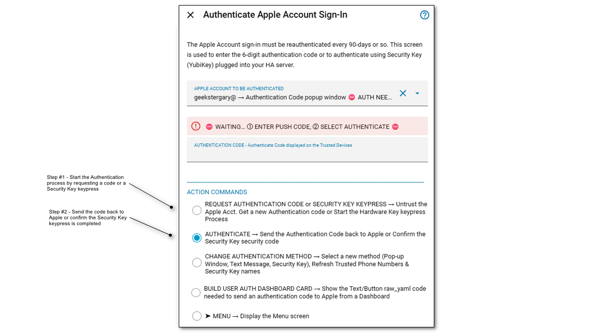
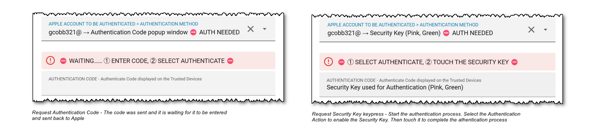
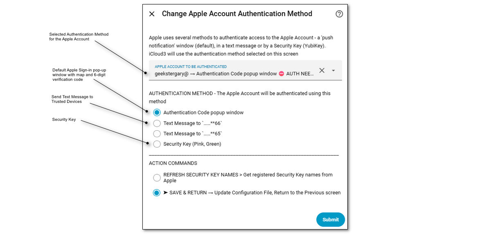
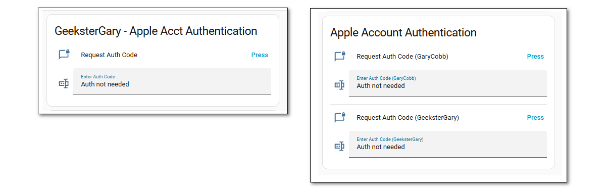
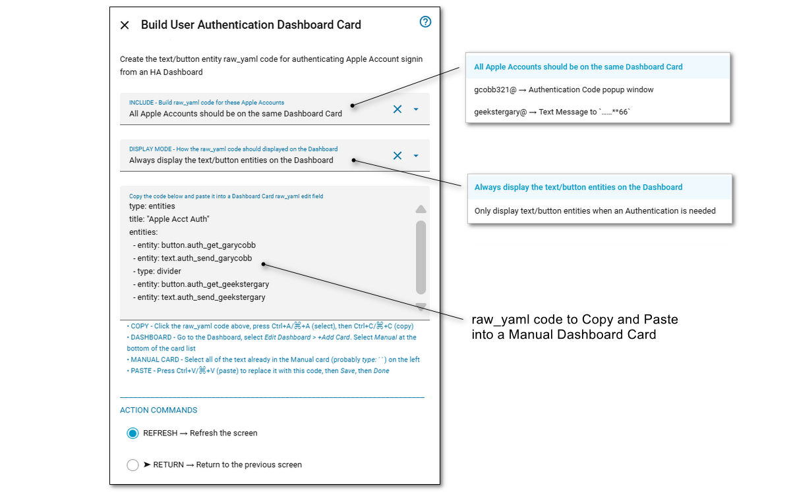

# Apple Account Authentication

Screens described below:

- **Authenticate Apple Account Sign-In** - The Apple Account sign-in must be reauthenticated every 90-days or so. This screen is used to enter the 6-digit authentication code or to authenticate using Security Key (YubiKey) plugged into your HA server.

  - **Change Apple Account Authentication Method** - Apple uses several methods to authenticate access to the Apple Account - a 'push notification' window (default), in a text message or by a Security Key (YubiKey). iCloud3 will use the authentication method selected on this screen

  - **Get an Authentication Code from Apple.com** - If you request an Authentication Code but the *Apple Acct Sign-in is Requested* window or the Text Message never arrives, follow these steps to generate one

When iCloud3 logs in the first time and then about every 90 days, access to your Apple Account needs to be authenticated again. iCloud3 supports three authentication methods:

- **Push notification** - The *Apple Id Sign in Requested... > 6-digit Verification Code* pop-up window

- **Text Messages** - Sending a text message to your Trusted Phone Numbers - These are set up on your Apple Account. On your iPhone/iPad, go to *Settings App > Your Apple Account > Sign-in & Security > Email & Phone Numbers*.

- **Security Keys (YubiKey)** - Touching the Security Key, when it is activated, will authenticate the access to your Apple Account.
  - An *Apple Account Sign-on* window is displayed on your iPhone when the key is activated in the Authentication step. You do not need to respond to it to complete the authentication. Select the 'OK' option to close the window.

!> The Security Key is inserted into your HA Server, not your iPhone or iPad.

>- See [here⧉](https://support.apple.com/en-us/122621) for information in Apple Support about Trusted Devices
>- See [here⧉](https://support.apple.com/guide/mac-help/add-or-remove-trusted-devices-mchl2310b175/mac) for information in Apple Support about Trusted Devices on a Mac
>- See [here⧉](https://support.apple.com/en-us/102637) for information in Apple Support about Security Keys

## Authenticate Apple Account Sign-in screens

The screen below is used to Authenticate Apple Account access and to configure how you want to do it:

- **Request an Authentication Code or Security Key Keypress** - *Step #1* - Start the authentication process. The screens below are displayed. It will untrust your Apple Account and then:

  - **Authentication Code Popup window** - Display *Apple Account Sign in..*. popup window and the code
  - **Text Message** - Sends the text message to the selected Trusted Device
  - **Security Key** - Gets ready for the Authentication step

  

- **Authenticate** - *Step #2* - Completes the authentication process, what you need to do:

  - **Authentication Code Popup window**, **Text Message**:
    1. Enter the 6-digit code in the Authentication Code field.
    2. Submit to send to Apple for verification.
  - **Security Key**:
    1. Submit to activate the keypress (it should now be blinking).
    2. Go to the HA Server and touch the Security Key. If it is not blinking, start over with the Request... step.

  #### General Notes:

  - **Apple Rejected the Code** - The code is valid for about 15-30 minutes. An error message is displayed if Apple rejects the Verification Code. Reenter it to verify if it was not entered incorrectly. If it is still rejected, request a new code.

  - **Security Keys** - Security Keys are set up on your iPhone/iPad, go to *Settings App > Your Apple Account > Sign-in & Security > Two-Factor Authentication > Security Keys*.

## Change Authentication Method

 This screen is used to select the authentication method to be used. Only active methods are displayed. It is opened on the *Authenticate Apple Account Sign-in* screen.

## Authenticating an Apple Account from a Dashboard Card

- Selected from the Authenticate Apple Account Sign-in Screen *(v3.8.0+ feature)*

Authenticating your Apple Account sign-in is normally done on the Configure > Authenticate Apple Account Sign-in screen. On this screen, you can request and send a code to Apple, authenticate using a Security key and change the authentication method for an Apple Account. This screen is only available to those who have HA Admin privileges. 

This can present several problems authenticating an account:

- If you are using more than one Apple Account and the owners of the other accounts do not have admin privileges.
- You do not have the Mobile App installed on a device and you do not access to the HA server.
- You are away from home, only have an iPhone with a small screen and using the Configure screen is difficult.

This feature provides a solution to these problems. With it, you can add a Text/Button entity to a dashboard card for each of your Apple Accounts and use them to request an authentication code, enter the code and send it to Apple for approval. 

### Dashboard Authentication Cards

The Dashboard Cards can only be used when an Apple account needs to be authenticated. Requesting or entering a code when an account does not need to be authenticated will not do anything. Below are dashboard cards that can be created. Instructions to create them are in a later section. 

To authenticate an account:

- **Requesting a cod**e - Press the Press button on the Request Auth Code line. This only works when an account needs to be authenticated. Use this when the code is not displayed on your device or it has expired.

- **Send the Code to App**le - Type the code in the Enter Auth Code line. You can add it to the end of any messages that are displayed. Then press Enter

  

### Build User Authentication Dashboard Card screen

This screen is used to generate the raw_yaml code for these cards.

The Apple Accounts that are displayed on the card is specified using the *Include parameter*. You can:

- Display all Apple accounts on one card
- Display only a specific Apple Account on a card

Their visibility status is selected using the *Display Mode paramete*r. They can:

- The card shows on the Dashboard all tie time
- The card is only visible when an authentication needs to be done

### Creating the User Authentication Card on a Dashboard screen

1. Opening the Configure > Authenticate Apple Sign-in screen > Build User Authentication Dashboard Card. The raw_yaml code for All Devices, Always Display is displayed on the screen.
2. To change the format:
   1. select the **Include parameter**, **Display Mode parameter**
   2. **Refresh**. The new raw_yaml code is displayed.
3. To copy the raw_yaml code:
   1. Click anywhere in the text area.
   2. **Ctrl+A or ⌘+A** to Select the text, then **Ctrl+C or ⌘+C** to Copy the text.
4. Close the iCloud3 Configure screen (Exit or click the 'X' in the upper-left corner).
5. **Go to the Dashboard** you want to add the User Authentication Card, go into **Edit mode**, Click **+Add Card**.
6. Select Manual Card (scroll to the bottom).
   1. Select the text in the area on the left (it probably has *type: '  '* ). 
   2. **Ctrl+V or ⌘+V** to paste the raw_yaml code
7. Click **Save** and then **Done**

